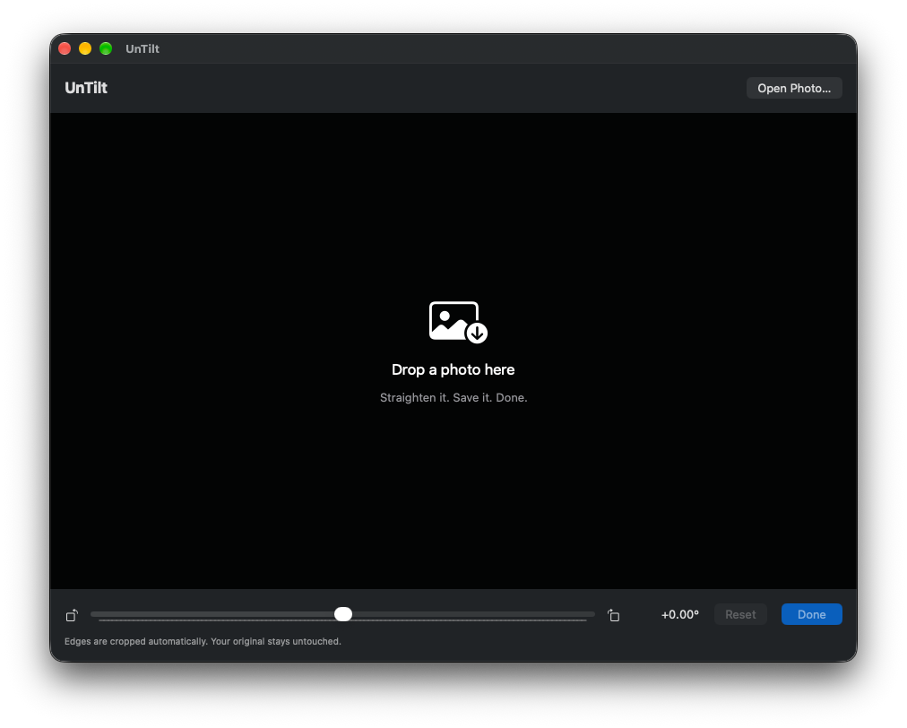

# UnTilt

UnTilt is a simple Mac app that lets you straighten photos by dropping in an image, adjusting the angle, and saving an aligned copy beside the original.

## Download

Download the ZIP from [Releases](https://github.com/mingistech/UnTilt/releases/latest), unzip it, and move UnTilt to Applications.

Requires macOS 27 or later.

## How it works

1. Drop a photo into the window, or click **Open Photo**.
2. Adjust the angle up to 30° in either direction. The grid helps align the horizon, and edges are cropped automatically.
3. Click **Done**. If prompted, allow access to the original folder.

The copy is saved as `filename_UnTilted.ext`. Repeat exports receive numbered names, and the original stays untouched. JPEG, PNG, HEIC, and TIFF are supported. Export preserves the file format and uses the source pixels for the cropped result; original photo metadata is not retained.

## Build

Open `UnTilt.xcodeproj` in Xcode with the macOS 27 SDK, select your signing team, and run the UnTilt scheme. The app icon is the included Icon Composer document, `UnTilt.icon`.
